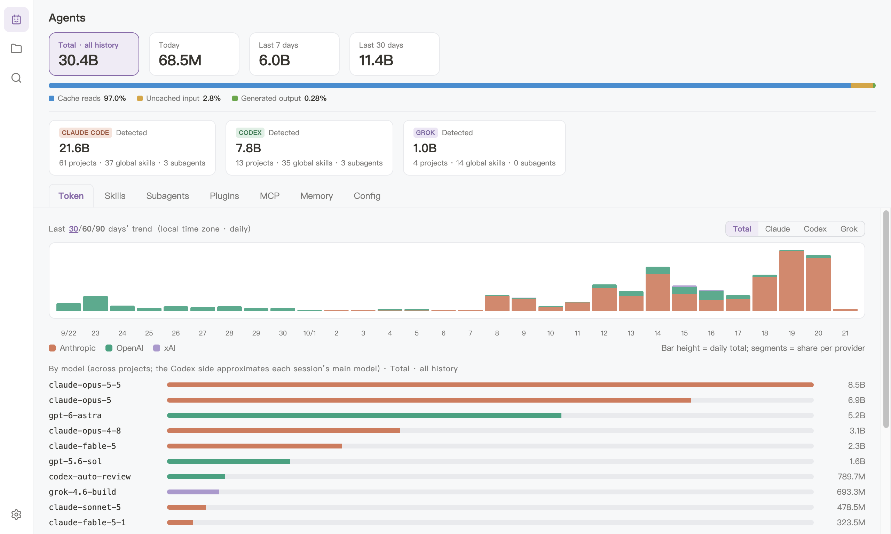

# Agentshed

[简体中文](README.md) · **English** · [Français](README.fr.md) · [Español](README.es.md) · [Русский](README.ru.md) · [日本語](README.ja.md)

**The tool shed for your coding agents.** A macOS app. See, across every project, which skills, plugins and
MCP servers Claude Code, Codex and other coding agents have installed, what they remember and how many tokens
they burned; revisit every session question by question, search what you asked across all of them, and install
skills from your global library into any project.

Website: [agentshed.aloongplanet.com](https://agentshed.aloongplanet.com)



## What it does

### Every agent at a glance

- The Agents page opens first: every agent side's global picture on one screen, with its token totals for
  all history, today, the last 7 days and the last 30, 60 or 90 days.
- Its sections gather what the agents have globally: skills, subagents, plugins, MCP servers, memory and
  configuration.

### Every project in one list

- Every project any agent side has registered, one directory to one project, sorted by activity. Search by
  name or path, narrow the list to one agent side, and show or hide projects whose directory is gone.
- A project's page shows what that project has as it actually takes effect there — skills, subagents,
  plugins, MCP servers, memory and configuration — the documents its agents produced, and its sessions.

### Skills, subagents, plugins and memory

- Filter a skills list by name, and expand a skill to read its package's files.
- Install a skill from your global library into a project as a full copy, or uninstall a project's copy: the
  app shows what it will delete and asks first.
- The agent sides' subagents in one view, showing which one applies in a project.
- Plugins grouped by agent side, with how each is installed and whether it is enabled; expand one to see the
  skills, subagents, hooks and MCP servers it bundles, and read its skills before enabling it.
- Memory: what an agent remembers about each project, summarised and in full.

### Token usage

- Token consumption per project and across all of them, split by day, project and model, with a daily trend
  over the last 30, 60 or 90 days.
- Each day's totals are archived, so the history survives an agent cleaning up or rewriting its own session
  files.

### Sessions

- A project's sessions, one per row with how many questions you asked. Open one to read it indexed by
  question, and expand a whole turn — its tool calls, subagents and reasoning — when you need it.
- Search a project's sessions by question, or in full text, and jump straight to the hit.
- A forked conversation shows only what is new since the fork, a branched one shows the branch you carried
  on, and anything that cannot be recovered is labelled.

### Global search

- Search what you asked across every project's sessions from a page of its own, or with ⌘⇧F from anywhere.
  Hits are grouped by project, and a hit opens its session at that question, inside its project.

### The app itself

- Light or dark, or following the system, in one of three themes.
- The interface follows the system's preferred language by default, or the language you pick.
- A new version downloads in the background and installs with one click, or when you quit.

## What it reads, changes and sends

- It reads the files your coding agents leave on your Mac: their configuration, installed components,
  memories and session records.
- It writes to them only when you install or uninstall a skill in a project. It never changes an agent's
  configuration.
- Its one use of the network is checking GitHub Releases for a new version of the app and downloading it.
  Nothing about your projects or sessions leaves your Mac.

## Requirements

macOS 12 or later, on Apple Silicon.

## Development

Agentshed is an Electron app, built with pnpm 9 and Node.js 22.

```sh
pnpm install
pnpm dev      # run the app, reloading as you edit
pnpm verify   # the full check: types, lint, unit tests, script and site tests, the copy and language
              # checks, the end-to-end tests on a fresh build, and a smoke run of the app in development
```

- [`docs/features/`](docs/features/README.md): what the app does today, feature by feature.
- [`docs/specs/`](docs/specs/README.md): the requirements behind each feature, and its edge cases.
- [`docs/adr/`](docs/adr/README.md): the architecture decisions.
- [`CONTEXT.md`](CONTEXT.md): the vocabulary the code and the documents share.
- [`site/`](site/README.md): the website, a project of its own.

## Licence

[MIT](LICENSE)
