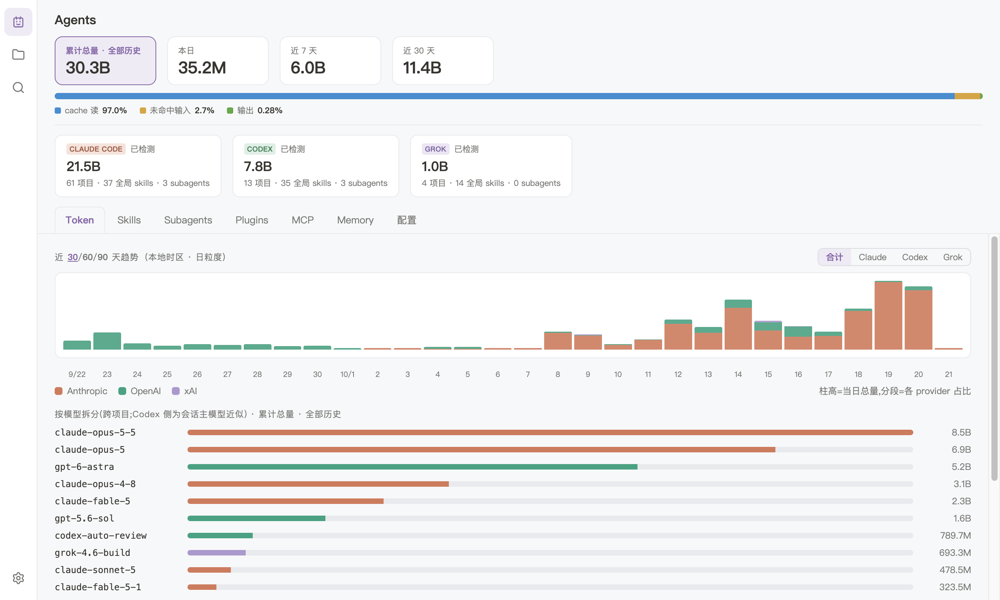

# Agentshed

**简体中文** · [English](README.en.md)

**你的 coding agent，尽收眼底。** 一个 macOS 应用。一处看清 Claude Code、Codex 等 coding agent 在每个项目里装了哪些 skills、plugins 与 MCP，记住了什么，烧了多少 token；每次会话按提问回看，所有项目一起搜索；还能把全局 skill 装进任意项目。

网站：[agentshed.aloongplanet.com](https://agentshed.aloongplanet.com)



## 能做什么

### 所有 agent 一屏看清

- 打开就是 Agents 页：每个 agent 侧的全局情况都在一屏上，token 用量分全部历史、今天、近 7 天和近 30 / 60 / 90 天。
- 各个分页汇总 agent 的全局内容：skills、subagents、plugins、MCP 服务、记忆与配置。

### 所有项目一张列表

- 任一 agent 侧登记过的项目都在一张列表里，一个目录算一个项目，按活跃时间排序。可以按名称或路径搜索，只看某一个 agent 侧，也可以显示或隐藏目录已不存在的项目。
- 项目页列出这个项目实际生效的 skills、subagents、plugins、MCP 服务、记忆与配置，以及 agent 在项目里产出的文档和项目的会话。

### Skills、subagents、plugins 与记忆

- skills 列表可以按名称筛选，展开一个 skill 就能阅读包里的文件。
- 把全局库里的 skill 整份复制装进某个项目，或卸载项目里的那份：删除前会列出要删的内容并请你确认。
- 各 agent 侧的 subagents 合在一处看，标出某个项目里实际生效的是哪一个。
- plugins 按 agent 侧分组，写明每个是怎么装的、是否启用；展开能看到它打包的 skills、subagents、hooks 与 MCP 服务，启用前就能先读它的 skills。
- 记忆：agent 记住了关于每个项目的什么，有摘要，也能看全文。

### Token 用量

- 按项目、也按全部项目合计看 token 用量，按天、按项目、按模型拆开，并有近 30 / 60 / 90 天的每日趋势。
- 每天的用量都会存档，agent 清理或改写自己的会话文件之后，历史照样在。

### 会话

- 项目的会话一行一个，写明这次对话里你问了几个问题。打开一个会话，按提问索引阅读；需要时展开一整轮，看其中的工具调用、子任务和推理过程。
- 在项目内按提问或全文搜索会话，直接跳到命中的那一处。
- fork 出来的会话只显示 fork 之后的新内容，有分支的会话显示你接着聊下去的那一支，无法还原的部分会明确标出。
- 会话页显示这个会话自己的 ID，可以一键复制；也能在 Finder 里定位它的记录文件，或复制一行 resume 命令：先进入项目目录，再用它所属 agent 的命令行工具接着这次对话。

### 全局搜索

- 在单独的搜索页里，或在任何地方按 ⌘⇧F，搜索你在所有项目的会话里问过的话。结果按项目分组，点开一条直接回到那次提问，在它所在的项目里。

### 应用本身

- 浅色、深色或跟随系统，三套主题可选。
- 界面语言默认跟随系统，也可以手动指定。
- 新版本在后台下载，点一下或退出时安装。

## 读什么、改什么、发什么

- 它读取 coding agent 留在你 Mac 上的文件：它们的配置、装好的组件、记忆和会话记录。
- 只有你在项目里安装或卸载 skill 时它才会写入这些文件，从不改动任何 agent 的配置。
- 它唯一的联网行为，是向 GitHub Releases 检查并下载应用的新版本。你的项目和会话的任何内容都不会离开你的 Mac。

## 下载与安装

需要 macOS 12 及以上、Apple Silicon(M 系列芯片)的 Mac。

1. 从 [Agentshed 官网](https://agentshed.aloongplanet.com/) 或 [GitHub Releases](https://github.com/aloong-planet/agentshed/releases) 下载 DMG。
2. 打开 DMG,把 Agentshed 拖进「应用程序」文件夹。
3. 从「应用程序」打开 Agentshed。第一次打开时,macOS 会询问一次是否打开这个从互联网下载的 App,并注明 Apple 已检查过它、未发现恶意软件;点「打开」即可。

## 开发

Agentshed 是一个 Electron 应用，使用 pnpm 9 与 Node.js 22。

```sh
pnpm install
pnpm dev      # 运行应用，改动后自动刷新
pnpm verify   # 完整检查：类型、lint、单元测试、脚本与网站测试、文案与语言检查、在新构建上跑端到端测试，以及开发模式下的冒烟运行
```

- [`docs/features/`](docs/features/README.md)：应用现在能做什么，按功能分篇。
- [`docs/specs/`](docs/specs/README.md)：每个功能背后的需求与边界情况。
- [`docs/adr/`](docs/adr/README.md)：架构决策。
- [`docs/CONTEXT.md`](docs/CONTEXT.md)：代码与文档共用的术语表。
- [`site/`](site/README.md)：网站，一个独立的项目。

## 许可

[MIT](LICENSE)
